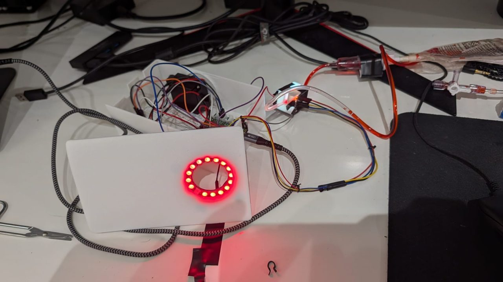
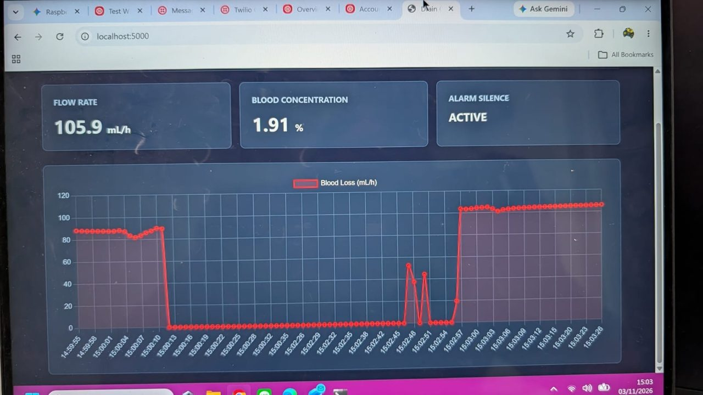
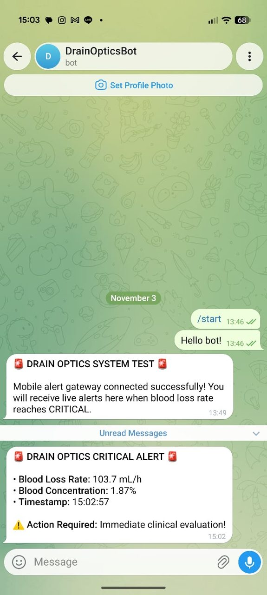

# Drain Optics: optical blood-loss monitor for surgical drain output

EXSU 620 Digital Prototyping, Project 01 (Group 1). Bench prototype.

After surgery, nurses judge bleeding from a drain by eye and write down a colour word. Drain Optics clips a colour sensor onto the drain tubing, measures how red the fluid is, converts that to **% blood** with a calibration curve, and estimates the **blood loss rate in mL/h**. A NeoPixel ring and a speaker raise alarms, and a button silences them.

> **Bench prototype only.** Dyed water stands in for blood. The alarm limits are bench demo values with no clinical basis. Not for use on patients.

## Repository layout

| Folder | Contents |
|---|---|
| [`firmware/`](firmware/) | MicroPython for the Raspberry Pi Pico 2 W. `main.py` is the monitor that runs the prototype. |
| [`firmware/tools/`](firmware/tools/) | `sensor1_read.py` (calibration helper), `hw_test.py` (wiring bring-up test). |
| [`firmware/archive/`](firmware/archive/) | `monitor_2sensor.py`: earlier two-sensor design with drop counting (not used in the final build). |
| [`cad/tube-clip/`](cad/tube-clip/) | Tube clip v4 (holds the sensor and white LED around the drain tube): STL, STEP, CadQuery source. |
| [`cad/enclosure/`](cad/enclosure/) | Electronics case v3: base, snap lid, light cap (STL + STEP), assembly STEP, CadQuery source. |
| [`docs/`](docs/) | Wiring diagrams, case pictures, serial data format ([`docs/serial-output.md`](docs/serial-output.md)). |
| [`docs/photos/`](docs/photos/) | Build log: photos of the prototype being built and tested. |
| [`docs/videos/`](docs/videos/) | Demo videos: device alarm states and the live dashboard. |
| [`report/`](report/) | Design dossier (D9, PDF), filled group report, failure modes list. |
| [`software/`](software/) | Placeholder for the software subgroup's laptop service and dashboard. |
| [`BOM.md`](BOM.md) | Bill of materials. |

## How it works

1. A white LED shines through the drain tube in the printed clip. A TCS34725 colour sensor on the other side reads red, green, blue and clear light.
2. Blood absorbs green light much more than red, so the **green/red ratio** falls as the fluid gets bloodier.
3. Absorbance `A = 1 − (g/r) / BASE_RATIO`, where `BASE_RATIO` is the clear-water g/r (1.3406 in our clip).
4. A four-point calibration curve converts A to % blood:

   | Absorbance A | 0.00 | 0.64 | 0.78 | 0.86 |
   |---|---|---|---|---|
   | % blood | 0 | 0.5 | 1.0 | 2.0 |

5. Blood loss rate (mL/h) = % blood / 100 × drain flow (mL/h). **One colour sensor cannot measure flow**, so `FLOW_MLH` is measured by hand (collect output for 5 min in a cup, mL × 12) and typed into `main.py`. The rate is therefore an estimate, not a measured flow rate.
6. Alarm states drive the light ring and speaker (see below).

## Hardware

Full parts list in [BOM.md](BOM.md). Wiring picture: [`docs/images/full-wiring.png`](docs/images/full-wiring.png) (the final build uses only sensor 1; ignore sensor 2 / drip chamber in that picture).

### Pin map (final, one sensor)

| Part | Connection |
|---|---|
| TCS34725 colour sensor (sensor 1, tube clip) | Grove I2C0: SDA GP8, SCL GP9, VIN 3V3, GND. Sensor's own LED pin → GND (onboard LED off). Address 0x29. |
| White LED (in the clip's light hole) | VBUS 5 V → 330 Ω → LED long leg (+); LED short leg (−) → GP15. GP15 LOW = LED on. |
| NeoPixel Ring 16 | Data In → GP18 (Grove D18), 5 V and GND from the same socket. |
| PAM8302 amplifier + 8 Ω speaker | A+ → GP20 (PWM tone), A− → GND, Vin → VBUS, SD left open. Speaker on the screw terminal. |
| Acknowledge button | GP16 ↔ GND (internal pull-up, 0 = pressed). |
| Power + data | Micro USB to the laptop. Grove shield switch set to 3V3. |

### Printed parts

| Part | File | Notes |
|---|---|---|
| Tube clip v4 | `cad/tube-clip/DrainOptics_TubeClip_v4.stl` | Black PLA (or wrap in black tape: white PLA leaks light). Sized for 4.1 mm OD IV tubing; measure yours and edit `tube_od` in `tube_clip_v4_cad.py`. |
| Case base | `cad/enclosure/T6_caseA_base_v1.stl` | 152 × 94 × 50 mm. Front panel holds the button (Ø16.2) and speaker grille. |
| Case lid | `cad/enclosure/T6_caseA_lid_v1.stl` | Snap fit, NeoPixel ring holder, light window. File is already upside down for printing. |
| Light cap | `cad/enclosure/T6_light_cap_v1.stl` | 44 × 44 × 15.3 mm. Translucent / white PLA, diffuses the ring. |

All print with no supports. To regenerate the models: `pip install cadquery`, then run `python tube_clip_v4_cad.py` or `python enclosure_v3_cad.py` in that folder.

### Build photos

See the [build log](docs/photos/README.md) for photos of each build step.



## Demo

| | |
|---|---|
| Live dashboard (software group) |  |
| Telegram CRITICAL alert |  |

Videos: [device going NORMAL → ADVISORY](docs/videos/demo-device-normal-to-advisory.mp4) (56 s) and [live dashboard](docs/videos/demo-dashboard-live.mp4) (17 s). On GitHub, click a video and then **View raw** to play it.

### Fluid rig

Dyed-water IV bag hung ~50 cm up → drip chamber → roller clamp → tubing through the tube clip → collection cup. Make calibration mixes by weight on the 0.1 g scale (1 g ≈ 1 mL). The scale is not used during a logging run.

## Running the firmware

1. Flash **MicroPython** for the Raspberry Pi Pico 2 W (hold BOOTSEL, plug in USB, drag the `.uf2` from micropython.org onto the drive).
2. Open **Thonny**, choose the MicroPython (Raspberry Pi Pico) interpreter.
3. (Optional) Run `firmware/tools/hw_test.py` to check every part is wired right.
4. Measure the drain flow (5 min in a cup, mL × 12) and set `FLOW_MLH` at the top of `firmware/main.py`.
5. Save `firmware/main.py` to the Pico as `main.py`. It starts on power-up. The `neopixel` module is built into MicroPython.
6. Watch the output in Thonny's shell. One line per reading:

   ```
   BLOOD_PCT:0.85% | EST_RATE:1.5 mL/h (at 180 mL/h flow) | STATE:ADVISORY | SPREAD:0.0123 | SILENCED:False
   ```

### Settings (top of `main.py`)

| Setting | Default | Meaning |
|---|---|---|
| `FLOW_MLH` | 180.0 | Measured drain flow, mL/h. Re-measure if the clamp moves. |
| `ADVISORY_PCT` | 0.5 | % blood for the amber alarm. |
| `CRITICAL_PCT` | 1.8 | % blood for the red alarm. |
| `HYST_PCT` | 0.1 | Hysteresis before stepping back down. |
| `STATIC_MS` / `STATIC_BAND` | 60 s / 0.2 % | Reading frozen this long = CHECK DRAIN. Tune using `SPREAD` in the output. |
| `SILENCE_MS` | 120 s | How long the button silences the sound. |
| `VOLUME` | 100 | Speaker PWM duty (0–65535). |

### Alarm states

| State | Ring | Sound | Trigger |
|---|---|---|---|
| NORMAL | green, filled in proportion to % blood | silent | below advisory |
| ADVISORY | amber | slow beep, 500 Hz | % blood ≥ 0.5 |
| CRITICAL | red | fast beeps, 1 kHz | % blood ≥ 1.8 |
| CHECK_DRAIN | cyan, full ring | long beep every 2 s | reading has not moved for 60 s (possible blocked or clotted line; never reported as "no bleeding") |
| AIR_BLANK | blue, full ring | long beep every 2 s | almost no light reaches the sensor (empty tube or unplugged sensor) |

Pressing the button silences the sound for 2 minutes; the light stays on. The sound returns early if the alarm becomes new or worse.

### Calibration

1. Fill the tube with clear water, run `firmware/tools/sensor1_read.py`, and record the averaged g/r ratio as `BASE_RATIO`.
2. Run each mix (0.5 %, 1 %, 2 % blood analogue) through the tube, wait for 10 lines, and record the averaged ratio.
3. Compute `A = 1 − ratio / BASE_RATIO` for each and update `CAL_POINTS` in `main.py`.

Measured on our rig (2026-11-02): useful range is below about 1 % blood; above that the curve flattens.

## Known limitations

These are reported in full in the design dossier (D7 verification report and D9 traceability matrix):

- Flow is entered by hand, not measured, so the mL/h figure is an estimate.
- Alarms are on % blood, not on the mL/h rate, and the "rate doubles within 30 min" rule (CR-2) is not on the device.
- No fouled-window, lamp-failure or saturation check in the final firmware.
- The laptop service, dashboard and Telegram notification were built and demonstrated by the software subgroup (see the Demo section); their source code goes in [`software/`](software/).
- Firmware is MicroPython, not the CircuitPython named on the project card.
- Bench only: dyed water does not scatter light like real drain fluid.

## Team

EXSU 620 Project 01, Group 1: calibration, software and hardware subgroups. Course lead: Dr. Hooshair.

## License

MIT, see [LICENSE](LICENSE).
